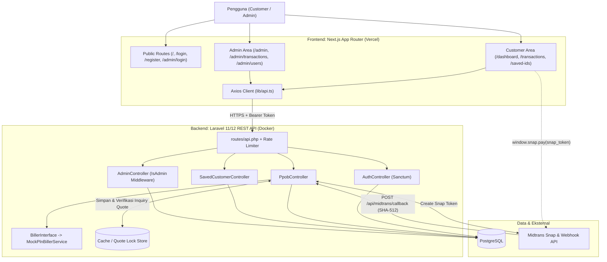
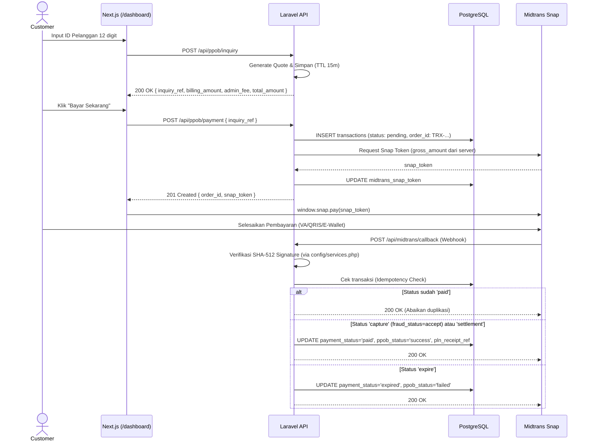

# Arsitektur Sistem — Pytricity

Dokumen ini menjelaskan arsitektur teknis, batasan komponen, pola desain, dan alur data kritis pada **Pytricity** versi *headless rebuild*.

---

## 1. Gambaran Umum Arsitektur

Pytricity menggunakan arsitektur **Headless Client-Server** dalam satu monorepo (`/backend` dan `/frontend`). Pemisahan ini memastikan logika bisnis finansial, validasi tagihan, dan kredensial Midtrans terisolasi sepenuhnya di *backend*, sementara *frontend* berfokus pada pengalaman pengguna dan manajemen status antarmuka.

---

## 2. Pola Desain Utama

### 2.1 Biller Adapter Pattern (`BillerInterface`)
Agar aplikasi portofolio dapat berjalan **100% gratis dan stabil 24/7** tanpa bergantung pada deposit aggregator PPOB pihak ketiga, sistem menggunakan *Dependency Injection* melalui kontrak `App\Contracts\BillerInterface`:
- **`MockPlnBillerService` (Default):** Menghasilkan respons tagihan PLN secara **deterministik** berdasarkan pola ID pelanggan (bukan angka acak murni tanpa konteks), sehingga skenario demo dapat diulang secara konsisten:
  - `111111111111` (atau akhiran ganjil): Tagihan normal aktif (misal Rp 145.000 + admin Rp 2.500).
  - `222222222222`: Tagihan daya besar (misal 3500 VA, Rp 480.000 + admin Rp 2.500).
  - `000000000000`: Simulasi galat *404 — ID Pelanggan tidak ditemukan atau tagihan bulan ini sudah lunas*.
- **Kesiapan Produksi:** Untuk beralih ke aggregator nyata (mis. Digiflazz, IAK, atau Alterra), cukup membuat implementasi baru `DigiflazzBillerService implements BillerInterface` dan mengganti *binding* pada `AppServiceProvider`.

### 2.2 Server-Side Inquiry Quote Lock (Anti-Manipulasi Harga)
Untuk menutup celah *client-side price tampering*:
1. Saat `POST /api/ppob/inquiry` berhasil, backend menghasilkan `inquiry_ref` unik (mis. `INQ-<UUID>`) dan menyimpan detail tagihan (`customer_number`, `customer_name`, `power`, `billing_amount`, `admin_fee`, `total_amount`, `user_id`) ke dalam **Cache/Store** dengan masa berlaku **15 menit** (TTL).
2. Saat `POST /api/ppob/payment`, klien **hanya mengirimkan `inquiry_ref`** (bukan nominal uang).
3. Backend mengambil nominal asli dari `inquiry_ref` yang terikat pada `user_id` tersebut, menghapus/mengunci *quote* agar tidak dipakai ganda, lalu membuat record `transactions` dan meminta `snap_token` ke Midtrans.

---

## 3. Alur Transaksi & Webhook Idempotency

---

## 4. Keamanan & Manajemen Sesi

1. **Sanctum Token Lifecycle:**
   - Token memiliki `expiration` **1440 menit (24 jam)** pada `config/sanctum.php`.
   - `POST /api/logout` wajib menghapus `currentAccessToken()` di basis data.
   - `POST /api/login` dilindungi *Rate Limiter* maksimal **5 percobaan per menit** per kombinasi email + IP.
2. **Konfigurasi Lingkungan Aman:**
   - Seluruh kredensial eksternal (`MIDTRANS_SERVER_KEY`, `MIDTRANS_IS_PRODUCTION`) diakses melalui `config/services.php`, **tidak pernah** memanggil `env()` langsung di dalam Controller agar aman saat `php artisan config:cache` aktif.
3. **Otorisasi Berbasis Peran (RBAC):**
   - Middleware `IsAdmin` memvalidasi `role === 'admin'` di sisi backend untuk seluruh rute `/api/admin/*`.
   - Rute pelanggan (`/api/ppob/*`, `/api/saved-customers/*`) membatasi kueri berdasarkan `Auth::id()` untuk mencegah *IDOR (Insecure Direct Object Reference)*.

---

## 5. Peta Evolusi Masa Depan (Phase 2 — Non-MVP)

Arsitektur disiapkan untuk pengembangan lanjutan **Area Mitra/Agen PPOB (`partner`)** pada Fase 2:
- Penambahan peran `'partner'` pada tabel `users`.
- Aktivasi tabel `wallets` dan `wallet_mutations` dengan penguncian baris atomik (`DB::transaction` + `lockForUpdate()`).
- Alur Top-Up Deposit Mitra via Midtrans dan halaman Kasir POS (`/partner/pos`).
