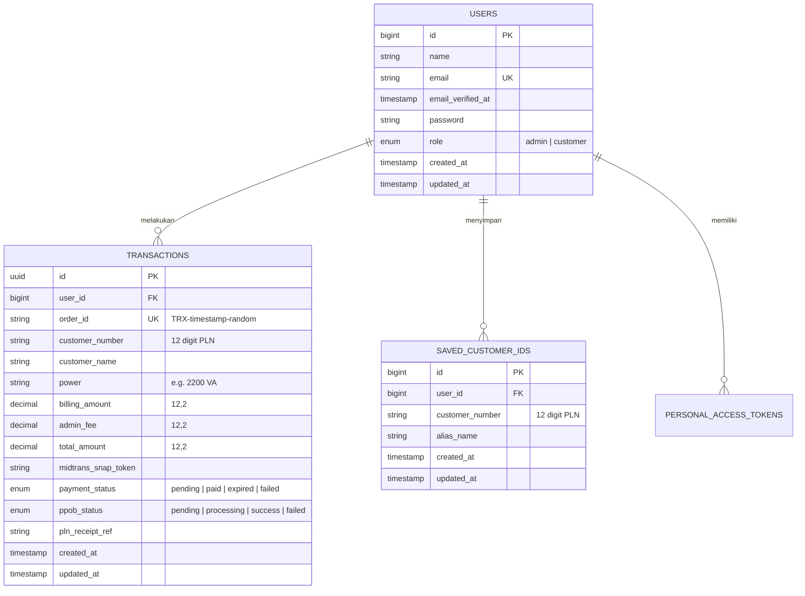

# Skema Basis Data — Pytricity (PostgreSQL)

Dokumen ini mendefinisikan struktur relasional PostgreSQL untuk MVP Pytricity serta rancangan perluasan Fase 2.

---

## 1. Entity Relationship Diagram (ERD)

---

## 2. Definisi Tabel MVP

### 2.1 `users`
Menyimpan akun pengguna terautentikasi.
- **Primary Key:** `id` (`BIGSERIAL`)
- **Constraints:** `email` `UNIQUE`, `role` `CHECK (role IN ('admin', 'customer'))` dengan *default* `'customer'`.
- **Catatan Migrasi:** Saat modul Partner diaktifkan di Fase 2, *constraint* `role` diperluas untuk menerima `'partner'`.

### 2.2 `transactions`
Menyimpan seluruh catatan transaksi pembayaran tagihan listrik.
- **Primary Key:** `id` (`UUID`)
- **Foreign Key:** `user_id` -> `users(id)` (`ON DELETE CASCADE`)
- **Kolom Kunci:**
  - `order_id` (`VARCHAR(64)`, `UNIQUE`, `NOT NULL`): Referensi unik yang dikirim ke Midtrans (`TRX-...`).
  - `customer_number` (`VARCHAR(12)`, `NOT NULL`): Nomor meter / ID Pelanggan PLN.
  - `customer_name` (`VARCHAR(255)`, `NOT NULL`): Nama pelanggan hasil *inquiry*.
  - `power` (`VARCHAR(32)`, `NOT NULL`): Golongan daya listrik (mis. `2200 VA`).
  - `billing_amount` (`DECIMAL(12,2)`, `NOT NULL`): Nominal tagihan pokok PLN.
  - `admin_fee` (`DECIMAL(12,2)`, `NOT NULL`): Biaya admin platform.
  - `total_amount` (`DECIMAL(12,2)`, `NOT NULL`): `billing_amount + admin_fee`.
  - `midtrans_snap_token` (`VARCHAR(255)`, `NULLABLE`): Token transaksi Midtrans Snap.
  - `payment_status` (`ENUM`: `pending`, `paid`, `expired`, `failed`).
  - `ppob_status` (`ENUM`: `pending`, `processing`, `success`, `failed`).
  - `pln_receipt_ref` (`VARCHAR(64)`, `NULLABLE`): Nomor referensi struk resmi PLN setelah lunas.
- **Indeks Disarankan:** Index pada `(user_id, created_at DESC)`, `payment_status`, dan `order_id`.

### 2.3 `saved_customer_ids`
Menyimpan daftar ID Pelanggan PLN favorit milik masing-masing pengguna.
- **Primary Key:** `id` (`BIGSERIAL`)
- **Foreign Key:** `user_id` -> `users(id)` (`ON DELETE CASCADE`)
- **Constraints:** `UNIQUE (user_id, customer_number)` untuk mencegah duplikasi nomor meter pada akun yang sama.

### 2.4 `personal_access_tokens`
Tabel standar Laravel Sanctum untuk manajemen token Bearer API.

---

## 3. Data Seeder Standar (`DatabaseSeeder`)

Untuk memastikan aplikasi siap didemokan langsung setelah `php artisan migrate --seed`:
1. **Akun Admin Demo:**
   - Email: `admin@pytricity.com` | Role: `admin`
2. **Akun Customer Demo:**
   - Email: `customer@pytricity.com` | Role: `customer`
   - Dilengkapi beberapa data contoh di `saved_customer_ids` dan `transactions` (`paid`, `pending`, `failed`) agar halaman Riwayat Transaksi dan Dashboard Admin langsung terisi secara realistis.

---

## 4. Rancangan Tabel Fase 2 (Non-MVP / Partner Module)

Tabel berikut disiapkan secara konseptual dan **tidak dibuat pada migrasi MVP** sebelum modul Mitra/Agen diaktifkan:
- **`wallets`:** `id`, `user_id` (FK unique), `balance` (`DECIMAL(14,2)`).
- **`wallet_mutations`:** `id`, `wallet_id` (FK), `transaction_id` (FK nullable), `type` (`credit | debit`), `amount` (`DECIMAL(14,2)`), `balance_after` (`DECIMAL(14,2)`), `description`.
